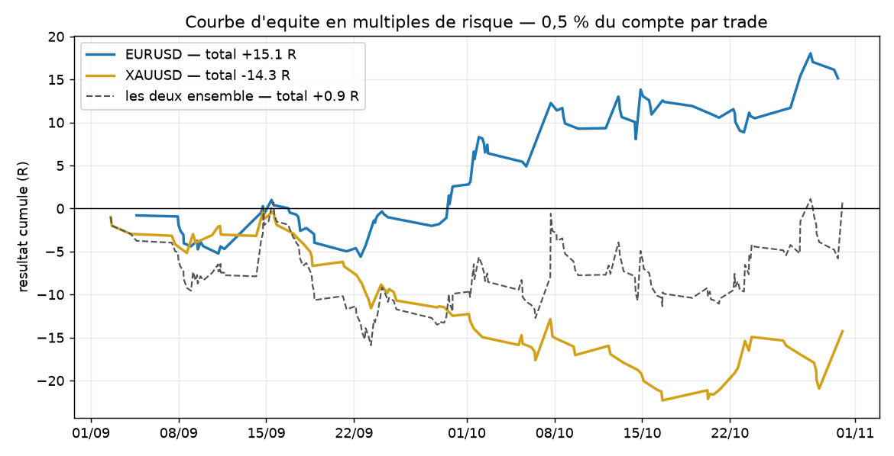
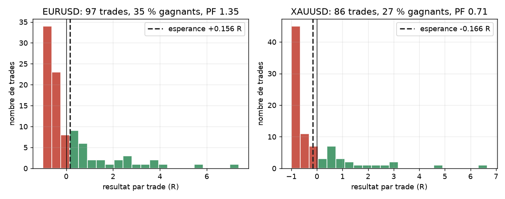
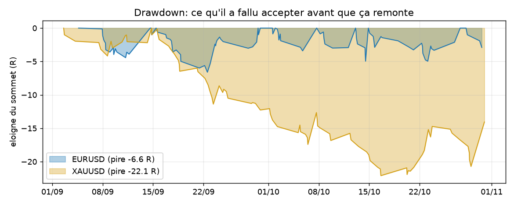
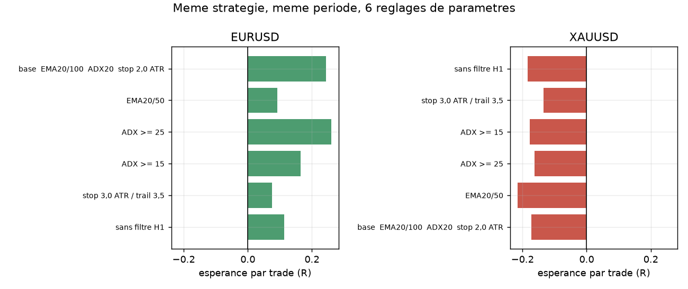
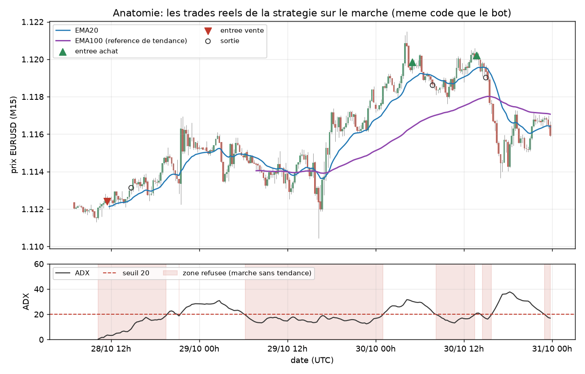

# Robot de trading MT5 — suivi de tendance M15

[](https://github.com/ck526438-lgtm/mt5-trend-bot/actions/workflows/verif.yml)


Un programme Python branché sur MetaTrader 5 : il lit les bougies M15 clôturées, décide,
et place des ordres avec **stop-loss obligatoire**, taille au risque fixe et coupe
journalière. Backtest sur l'historique réel, mode papier, mode réel, journal de trades.

**Ce dépôt n'est pas une promesse de gain.** Les chiffres complets sont plus bas, y compris
ceux qui ne plaident pas pour le système — c'est ce qui rend le reste lisible.



---

## Ce que les données disent

2 mois de bougies M15 (septembre–octobre 2026), spread réel inclus, risque 0,5 % du compte
par trade. Résultat exprimé en **R** : 1 R = la distance de ton stop. +1 R = tu gagnes ce
que tu aurais perdu si ton stop avait été touché.

| Symbole | Trades | Win rate | Profit factor | Espérance | Drawdown max | Sur 2 mois |
|---|---|---|---|---|---|---|
| **EURUSD** | 97 | 35,1 % | **1,35** | **+0,156 R** | 3,3 % | +7,5 % |
| **XAUUSD (or)** | 86 | 26,7 % | **0,71** | **−0,166 R** | 10,6 % | −7,1 % |
| Les deux | 183 | 31,1 % | 1,01 | +0,005 R | 10,6 % | ±0 % |



Trois lectures honnêtes :

1. **Sur l'or, ce système perd**, et il perd dans les 6 variantes de paramètres testées. Le
   suivi de tendance M15 se fait hacher par le bruit de l'or sur cette période. Ce n'est pas
   un réglage à trouver, c'est une paire à retirer.
2. **Sur EURUSD ça passe, mais c'est mince.** 35 % de trades gagnants : le système perd
   souvent et gagne gros (+1,70 R en moyenne contre −0,68 R). C'est le comportement normal
   du suivi de tendance — et il faut accepter des séries de 8 pertes consécutives (constatées
   sur les deux symboles) pour laisser courir les gains.
3. **183 trades, 2 mois, un seul régime de marché.** Un faisceau d'indices, pas une preuve.



---

## Le test qui compte : la sensibilité aux paramètres

Même stratégie, même période, 6 jeux de paramètres. C'est la figure à regarder avant de
croire un profit factor.



Sur 3000 bougies M15 et 6 jeux de paramètres ([sensitivity.py](sensitivity.py), reproductible
avec `python sensitivity.py`) :

- **EURUSD : espérance positive dans les 6 variantes**, de +0,075 R à +0,26 R ;
- **XAUUSD : négative dans les 6**, de −0,135 R à −0,215 R.

Donc le **signe** est robuste et la conclusion sur l'or ne dépend pas d'un réglage mal choisi.
Mais l'**amplitude** varie du simple au triple selon le réglage : le chiffre exact que tu
annonces à quelqu'un dépend davantage de ton paramétrage que du marché. C'est pour ça que la
seule question qui vaille est « est-ce que ça tient dans tous les réglages plausibles ? », pas
« quel est le meilleur profit factor ? ».

---

## Anatomie : à quoi il regarde



Sur chaque **bougie M15 clôturée** (jamais sur une bougie en cours, qui n'a pas encore sa
forme définitive) :

1. **Tendance** : EMA20 au-dessus/en-dessous de l'EMA100, prix du bon côté de l'EMA100.
2. **Cadre supérieur** : le sens doit être le même qu'en H1 (dernière bougie H1 terminée,
   donc aucun regard vers le futur).
3. **Qualité** : ADX ≥ 20. En dessous, le marché range et le suivi de tendance se fait scier.
4. **Pas de poursuite** : si la bougie est déjà à plus de 1,8 ATR de son EMA20, le train est parti.
5. **Garde-fous** : heures, spread, nombre de positions simultanées, coupe journalière, quota.
6. **Taille** : `lots = (capital × 0,5 %) / (distance_du_stop × taille_du_contrat)`, arrondie
   au pas du broker. Si le lot minimum imposait un risque supérieur de plus de 50 % à la
   cible, le robot **refuse le trade** au lieu de sur-exposer.
7. **Sortie** : stop suiveur à 2,5 ATR qui ne recule jamais, ou retournement EMA20/EMA100.
   Pas de take-profit fixe — c'est ce qui laisse les gains courir, et c'est aussi pour ça que
   le win rate est bas.

Le backtest et le bot appellent **les mêmes fonctions** ([strategy.py](strategy.py)) : ce qui
est mesuré est ce qui s'exécute.

---

## Démarrer

Prérequis : Python 3.10+ sous Windows, et MetaTrader 5 installé et connecté à un compte.
Le bot utilise la session ouverte dans le terminal — **il ne manipule aucun mot de passe**.

```bash
pip install MetaTrader5 pandas numpy matplotlib
```

```bash
python backtest.py      # met à jour backtest_summary.json et backtest_trades.csv
python bot.py           # lance le robot (mode papier par défaut)
python resume.py        # analyse le journal trades.csv accumulé
python make_charts.py   # régénère les images de ce README
```

Sous Windows, les mêmes commandes sont disponibles en double-clic : `setup.bat`,
`run_backtest.bat`, `run_bot.bat`, `run_resume.bat`, `stop_bot.bat`.

Le bot ne vit que tant que sa fenêtre est ouverte. Les positions déjà placées gardent leur
stop chez le broker si le PC s'éteint. **Arrêt d'urgence :** `stop_bot.bat` (crée un fichier
`STOP` que le bot détecte en moins de 3 s).

---

## Passer en argent réel

`python passer_en_live.py` (ou `passer_en_live.bat`) affiche d'abord ce que le backtest dit
vraiment, puis demande de taper `LIVE`. Trois portes se ferment ensuite :

| Porte | Condition | Contournement |
|---|---|---|
| 1. Intention | `confirm_live: true` dans `config.json` | le script le fait après ta frappe |
| 2. Compte | le compte connecté dans MT5 doit être un compte **réel** | aucun (c'est technique) |
| 3. Preuve | espérance > 0 R **et** profit factor ≥ 1,2 **par symbole tradé** | `"override_backtest_gate": true` |

Aujourd'hui la porte 3 est fermée tant que l'or reste dans `symbols`. À toi de choisir :
retirer `"XAUUSD"` de [config.json](config.json) — EURUSD seul remplit la condition — ou
forcer, en sachant que tu trades alors sans avantage mesuré.

**Conseil :** 100 à 200 trades en papier d'abord. En dessous d'une centaine de trades
clôturés, la différence entre un système gagnant et un système perdant tient dans le bruit.

Le dépôt reste livré avec `confirm_live: false` : la vérification automatique (`.github/workflows/verif.yml`)
échoue si cette valeur part avec un push, pour qu'un réglage prêt à envoyer des ordres réels
ne traîne pas en public.

---

## Réglages (`config.json`)

| Clé | Défaut | Effet |
|---|---|---|
| `mode` | `paper` | `paper` = simulation sur prix réels, `live` = ordres réels |
| `symbols` | EURUSD, XAUUSD | actifs suivis |
| `timeframe` | `M15` | unité de temps des décisions |
| `strategy.ema_fast` / `ema_slow` | 20 / 100 | définition de la tendance |
| `strategy.htf_timeframe` | `H1` | filtre de cadre supérieur (vide = désactivé) |
| `strategy.adx_min` | 20 | exigence de marché tendu |
| `strategy.atr_stop_mult` / `atr_trail_mult` | 2,0 / 2,5 | distance du stop et du suiveur, en ATR |
| `strategy.max_bar_expansion_atr` | 1,8 | refuse de chasing une bougie déjà étirée |
| `risk.risk_pct_per_trade` | 0,5 | % du compte risqué par trade — **le vrai levier de survie** |
| `risk.max_daily_loss_pct` | 2,0 | au-delà, plus aucune entrée jusqu'à minuit UTC |
| `risk.max_open_positions` / `max_trades_per_day` | 2 / 8 | exposition et fréquence |
| `risk.trade_hours_utc_start` / `end` | 8 / 21 | plage de trading (UTC) |
| `risk.max_spread_points` | 35 or / 20 EUR | refuse une entrée quand le spread dérape |
| `risk.min_lots` / `max_lots` | 0,01 / 5,0 | bornes de taille de position |
| `paper.start_balance` | 1000 | capital virtuel du mode papier |

---

## Limites connues, sans maquillage

- **Horizon court.** Allonge `backtest.bars` dans `config.json` (30000 ≈ 12 mois de M15) et
  relance le backtest si ton broker fournit cette profondeur : c'est le seul changement qui
  peut réellement améliorer la confiance dans ces chiffres.
- **Pas de slippage ni de commission.** Les stops sont supposés remplis exactement à leur
  prix. En réel, les mèches de news glissent : compte 0,05 à 0,1 R de moins par trade, ce qui
  mange une bonne part de l'edge EURUSD mesuré ici.
- **Rien sur les annonces économiques.** Les horaires sont un filtre, pas une protection :
  une décision de banque centrale à 14h30 UTC peut traverser le stop bien plus loin que prévu.
- **Latence Python.** Le bot interroie le terminal toutes les 2 s ; il ne fera jamais du
  scalping, et ce n'est pas le but.
- **Une fenêtre de décision par bougie.** Si le PC est endormi au moment de la clôture, le
  signal est manqué.
- **La coupe journalière n'aplatit pas tout** : elle bloque les nouvelles entrées. Les
  positions ouvertes restent protégées par leur stop côté broker.

## Fichiers

| Fichier | Rôle |
|---|---|
| [config.json](config.json) | tous les réglages |
| [bot.py](bot.py) | boucle de trading, modes papier et réel |
| [strategy.py](strategy.py) | indicateurs et décision, partagée backtest/bot |
| [risk.py](risk.py) | taille de position, spread, heures, coupe journalière |
| [mt5_client.py](mt5_client.py) | connexion terminal, données, ordres |
| [backtest.py](backtest.py) | mesure sur historique, écrit `backtest_summary.json` |
| [sensitivity.py](sensitivity.py) | balayage de 6 réglages, écrit `sensitivity.csv` |
| [resume.py](resume.py) | analyse du journal `trades.csv` |
| [make_charts.py](make_charts.py) | régénère `docs/img/` |
| [passer_en_live.py](passer_en_live.py) | bascule en réel avec double validation |

---

## Avertissement

Le trading sur marge comporte un risque de perte rapide et totale du capital. Ce code est
fourni à des fins d'étude et de test personnel : aucune garantie de performance, aucun
conseil financier. Les résultats de backtest ne préjugent pas des résultats réels. Tu es seul
responsable des ordres envoyés sur ton compte, y compris en mode `live`.
